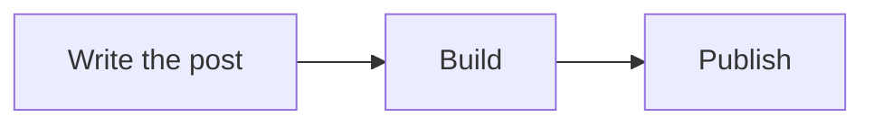

import Example from "../../../../../components/Example.astro";

Draws a Mermaid diagram, such as a flowchart or a sequence diagram, in a frame, in the colours of the page.

<Example system="personal-website" name="mermaid" title="A flowchart on the cream frame and a sequence diagram on the dark one" />

## When to use

Use it when the shape of a process or a structure is the point. A list of steps reads better as [Steps](../steps/).

## In a post

Write a code fence with the language `mermaid`:

````md

````

| In the fence | What it does |
| --- | --- |
| `title="..."` | An uppercase label inside the frame |
| `caption="..."` | One line under the frame |

The diagram is drawn in the browser. The mermaid library is fetched only on a page that has a diagram, as a separate file, and until it has drawn, the frame shows the diagram's source.

## Anatomy

A DiagramFrame: the canvas with a hairline and `--radius-lg` corners, an optional label in its top left, the diagram centred, and an optional caption below.

## Variants

| Prop | Values |
| --- | --- |
| `tone` | `cream` (default), the canvas frame; `dark`, the dark frame, with the dark token pairs |

DiagramFrame on its own takes any drawing: an SVG string in `svg`, any element in its slot, or `source` to show the source. It also has `label`, `caption`, `align` (`center` or `start`) and `padding` (`none`, `sm`, `md`, `lg`).

## States

| State | What changes |
| --- | --- |
| Loading | The source shows in muted mono until mermaid has drawn the diagram. If drawing fails, the source stays |
| Theme change | Mermaid writes its colours into the drawing, so the diagram is drawn again when the page switches between light and dark |

## Accessibility

The colours come from the tokens: nodes sit on the card colour with the ink text colour, and coral is kept for the page's actions. Mermaid's drawing is an SVG with its text as real text, so it can be selected and read. A long diagram scrolls sideways inside the frame.

## API

[`Mermaid.astro`](https://github.com/RottenSea/design-system/blob/main/systems/personal-website/src/components/content/Mermaid.astro) and [`DiagramFrame.astro`](https://github.com/RottenSea/design-system/blob/main/systems/personal-website/src/components/content/DiagramFrame.astro). DiagramFrame keeps the handoff's props and never draws. Mermaid is not in the handoff; it follows the handoff's advice for drawing in the browser and its mapping of tokens to Mermaid's theme.

## Related

[MathBlock](../math-block/), for formulas.
