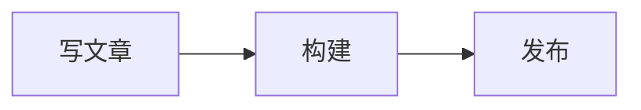

import Example from "../../../../../components/Example.astro";

在一个框里画出 Mermaid 图，例如流程图或时序图，颜色和页面一致。

<Example system="personal-website" name="mermaid" title="浅色框里的流程图和深色框里的时序图" />

## 什么时候用

要讲清楚一个流程或结构的形状时用。一串步骤用 [Steps 步骤条](../steps/) 更好读。

## 文章里怎么写

写一个语言是 `mermaid` 的代码块：

````md

````

| 写法 | 作用 |
| --- | --- |
| `title="..."` | 框里左上角的大写小标题 |
| `caption="..."` | 框下面的一行说明 |

图在浏览器里画。只有页面上有图时才下载 mermaid，它是单独的一个文件；画好之前，框里显示图的源码。

## 结构

一个 DiagramFrame：页面底色加细线边框、`--radius-lg` 圆角，左上角可以有小标题，图居中，下面可以有一行说明。

## 类型

| 属性 | 取值 |
| --- | --- |
| `tone` | `cream`（默认），浅色框；`dark`，深色框，用深色的那组 token |

DiagramFrame 本身可以放任何图：`svg` 传 SVG 字符串，插槽里放任意元素，或者只传 `source` 显示源码。它还有 `label`、`caption`、`align`（`center` 或 `start`）和 `padding`（`none`、`sm`、`md`、`lg`）。

## 状态

| 状态 | 变化 |
| --- | --- |
| 加载中 | 用浅色等宽字显示源码，直到 mermaid 画好；画失败了就一直显示源码 |
| 切换主题 | Mermaid 把颜色写死在图里，所以页面在浅色和深色之间切换时会重画 |

## 无障碍

颜色取自 token：节点用卡片底色和墨色文字，珊瑚色留给页面上的操作。Mermaid 画出的是 SVG，里面的文字是真正的文字，可以选中、可以被读出来。很长的图在框里横向滚动。

## API

[`Mermaid.astro`](https://github.com/RottenSea/design-system/blob/main/systems/personal-website/src/components/content/Mermaid.astro) 和 [`DiagramFrame.astro`](https://github.com/RottenSea/design-system/blob/main/systems/personal-website/src/components/content/DiagramFrame.astro)。DiagramFrame 的 props 和交付包一样，自己不画图。交付包里没有 Mermaid 组件；它按交付包对“在浏览器里画”的建议，以及 token 到 Mermaid 主题的对应来做。

## 相关

[MathBlock 数学公式](../math-block/)，用于公式。
